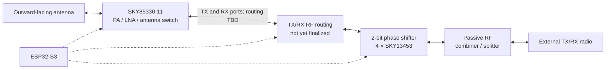

# UCA-12

**A 12-element, 2.4 GHz circular phased-array antenna — open hardware in development.**

UCA-12 is an experimental uniform circular array (UCA) with twelve radially outward-facing antenna elements mounted around a central controller PCB. The project aims to explore **electronically selectable reception and transmission directions across 360° of azimuth** using low-cost RF switches, PCB transmission-line phase shifters, and an ESP32-S3.

> [!IMPORTANT]
> **Design-stage project, not validated RF hardware.** The antenna pattern, achievable beamwidth, shared TX/RX routing, matching, and regulatory compliance have not yet been verified. The target of approximately **30° directional sectors** is a goal, **not** a demonstrated half-power beamwidth or angular resolution.

## Design at a glance

| Parameter | Current plan |
| --- | --- |
| Operating frequency | Approximately 2.4 GHz |
| Array geometry | 12-element uniform circular array; radial, outward-facing elements |
| Angular spacing | 30° between adjacent elements |
| Intended coverage | 360° azimuth; elevation steering not a goal |
| Phase control | 2 bits per element (nominal 0°, 90°, 180°, 270°) |
| Phase-shifting architecture | Two cascaded switched-delay-line stages per element |
| RF switch | **Skyworks SKY13453-385LF** (4 per element) |
| PA/LNA front-end | **Skyworks SKY85330-11** (1 per element) |
| Controller | ESP32-S3 (planned) |
| RF distribution | Passive combining/splitting network; topology not finalized |
| TX/RX | Both intended; shared-path switching requires further design |
| PCB designs | `antenna-element-v1`, `phased-array-controller-v1` |

At 2.4 GHz, free-space wavelength is about **125 mm**, and half a wavelength is approximately **62.5 mm**. The final array diameter, element spacing, radiation patterns, and mutual coupling still require electromagnetic simulation. Radially facing antennas do **not** automatically produce a 30° receive beam: pattern overlap and the chosen beamforming weights matter.

## Hardware architecture

The project is divided into two custom PCB designs:

**`antenna-element-v1`** — One of 12 identical outward-facing antenna boards. Each carries an antenna element and a SKY85330-11 front-end module incorporating a transmit power amplifier, receive low-noise amplifier, and RF switching. The front end connects to the center board through RF feed(s) and control wiring.

**`phased-array-controller-v1`** — The central PCB with the ESP32-S3, twelve independently selectable 2-bit phase-shifting networks, RF distribution/combining, and TX/RX control and routing. The central board is more than a beamformer: it serves as the RF and digital control hub.

### Signal flow (conceptual)



This represents **one antenna channel**; the complete array repeats the antenna, front end, routing, and phase shifter **12 times**, then connects the channels through the shared RF network.

In receive mode, amplification should occur near the antenna **before** lossy feed lines and phase-switching networks. In transmit mode, each PA must receive a correctly routed drive signal. The FEM's TX and RX RF connections must **not** be directly tied together; a suitable switching or separate-path architecture is still to be selected.

## Low-cost 2-bit phase shifter

Each element uses **four SKY13453-385LF SPDT RF switches** arranged as two switched-delay-line stages:

- **180° stage:** Two switches select either a reference trace or a trace with approximately 180° additional electrical length.
- **90° stage:** Another two switches select a reference trace or a trace with approximately 90° additional electrical length.

Together the two control bits select four nominal states:

| Control bits | Nominal relative phase |
| --- | ---: |
| `00` | 0° |
| `01` | 90° |
| `10` | 180° |
| `11` | 270° |

```text
                        Stage 1: 180°                 Stage 2: 90°
                     ┌──── short ────┐             ┌──── short ────┐
RF input ── SW1 ─────┤               ├── SW2 ─ SW3 ┤               ├── SW4 ─ RF output
                     └── long +180° ─┘             └── long +90° ─┘
                      1 phase bit                    1 phase bit
```

The **long** and **short** paths are 50 Ω controlled-impedance PCB transmission lines, not ordinary arbitrary traces. Their required physical length differences depend on the board stack-up, effective dielectric constant, switch parasitics, and operating frequency. The diagram is a **topology sketch, not a manufacturing schematic**. Actual phase and insertion loss must be measured and calibrated.

For the complete array: **12 × 4 = 48 RF switches**; **two logical phase-control bits per element = 24 control bits**.

## ESP32-S3 control

The current plan is to use **24 dedicated GPIO outputs** for phase selection, with additional pins for FEM TX/RX selection and other control functions. Each phase bit drives a coordinated pair of SPDT switches; the actual switch truth table and control wiring must be checked against the datasheet.

**Electrical warning:** The SKY13453-385LF's control input must **not** be driven directly by an ESP32-S3's 3.3 V GPIO if it exceeds the RF switch's specified VCTL limit. The current design notes specify **VCTL ≤ 3.0 V and ≤ VDD**; use appropriate level translation, and confirm all control voltage limits before schematic release.

## Preliminary bill of materials

The following is the **current selected IC set**, not a complete manufacturing BOM:

| Part | Purpose | Per array | Planned purchase |
| --- | --- | ---: | ---: |
| Skyworks **SKY13453-385LF** | SPDT RF switch for switched-delay phase stages | 48 | 50 (2 spares) |
| Skyworks **SKY85330-11** | 2.4 GHz PA/LNA RF front-end module | 12 | 13 (1 spare) |
| **ESP32-S3** (module/version TBD) | Phase and FEM controller | 1 | TBD |
| RF combiner/splitter, RF routing, passives, connectors | Shared RF network | TBD | TBD |

An earlier pricing estimate for the **planned spare-inclusive quantities** was **$24.28 for 50 SKY13453 switches** and **$41.73 for 13 SKY85330 modules**, or **$66.01 combined before fees**. These are **historical planning estimates**, not live quotes; tariffs, shipping, PCBs, matching components, and test equipment are excluded.

### Component documentation

- [SKY13453-385LF datasheet (Skyworks)](https://www.skyworksinc.com/-/media/SkyWorks/Documents/Products/1901-2000/SKY13453-385LF_202830G.pdf)
- [SKY85330-11 product summary (Skyworks)](https://www.skyworksinc.com/-/media/SkyWorks/Documents/Products/2801-2900/SKY85330_11_204868A_PS.pdf)
- [SKY13453-385LF distributor listing](https://www.digikey.com/en/products/detail/skyworks-solutions-inc/SKY13453-385LF/5214219)
- [SKY85330-11 distributor listing](https://www.digikey.com/en/products/detail/skyworks-solutions-inc/SKY85330-11/16579819)

## Repository layout

Proposed layout as the project develops:

```text
UCA-12/
├── hardware/
│   ├── antenna-element-v1/         # KiCad antenna / FEM PCB
│   └── phased-array-controller-v1/ # KiCad center RF / control PCB
├── firmware/                       # ESP32-S3 beam control (planned)
├── simulation/                     # RF / antenna simulation (planned)
├── docs/                           # Architecture and design notes
└── README.md
```

## Development status / next steps

- [x] Define 12-element circular, radially oriented array concept
- [x] Select SKY13453-385LF for low-cost, two-stage switched-delay phase shifting
- [x] Select SKY85330-11 as the intended antenna-board RF front end
- [x] Name the two PCBs and choose ESP32-S3 as the intended controller
- [ ] Validate front-end pinout, biasing, TX/RX truth table, and shared bidirectional RF path
- [ ] Design control-voltage translation and safe power-up states
- [ ] Simulate and measure 90° / 180° switched-delay lines at 2.4 GHz
- [ ] Select and simulate the RF combiner/splitter network
- [ ] Simulate the complete circular array, element patterns, coupling, and beam shape
- [ ] Finalize KiCad schematics, layout, stack-up, matching, and connectors
- [ ] Assemble a single-channel RF prototype and measure insertion loss / phase
- [ ] Validate the 12-channel array and TX power / emission compliance

## Safety and compliance

This is a radio-frequency engineering prototype. **Do not assume that operation in the 2.4 GHz ISM band automatically permits any transmit power or antenna configuration.** Before transmitting, evaluate aggregate conducted output, antenna gain and EIRP, unwanted emissions, local regulations, and any applicable equipment authorization requirements. Initial receive-only and low-power conducted testing is recommended.

## License

**License decision pending.** Hardware licensing options under consideration include **CERN-OHL-P-2.0** and **CERN-OHL-W-2.0**; firmware may use a separate software license. Do not assume a particular open-source license applies until license files and appropriate notices have been added.

---

**Project status:** Preliminary engineering concept · **Current design baseline:** v2 · **Updated:** October 2026
